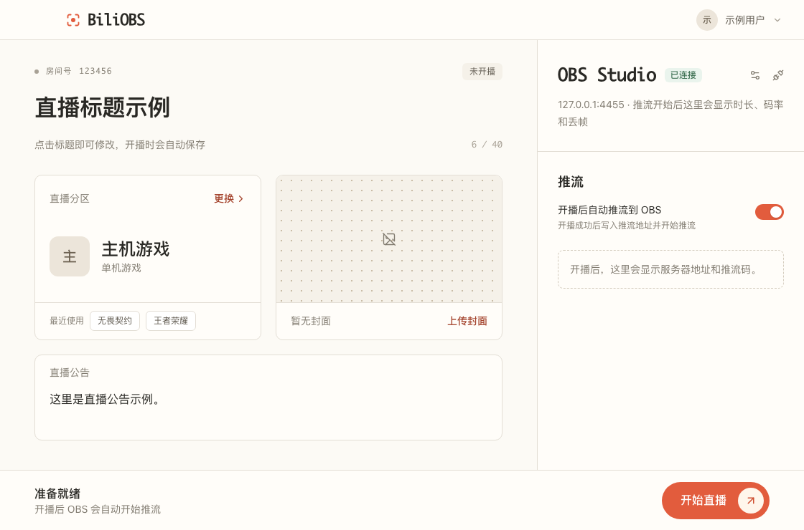
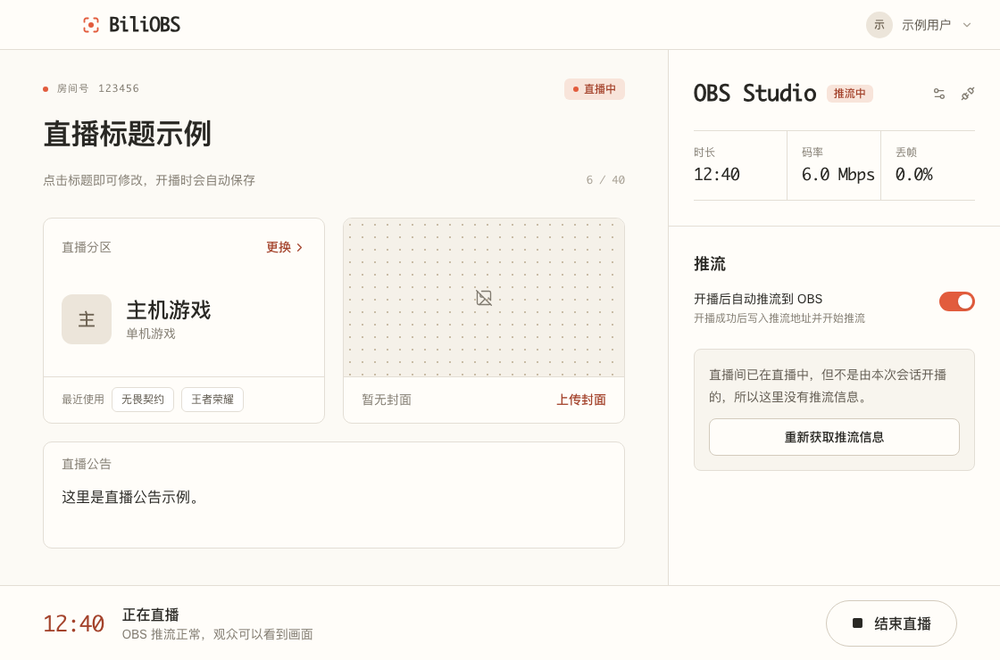

<div align="center">

# BiliOBS

**B站 OBS 开播助手**

在 OBS Studio 中一键开播到哔哩哔哩直播：扫码登录、选分区、点开播，推流地址自动写入 OBS 并开始推流。

`Tauri 2` · `Rust` · `React` · `obs-websocket v5`

</div>

> [!CAUTION]
> **使用前请完整阅读[风险与免责声明](#风险与免责声明)。**
> 本项目是非官方工具，与哔哩哔哩、OBS Project 均无任何关联。它调用的是未公开的接口，
> 存在账号被风控或处罚的可能；接口随时可能被调整而导致工具失效。
> 本项目仅面向**在自己的直播间进行合规直播的个人主播**，严禁用于任何违法违规用途。

---

## 项目背景

2025 年 5 月 12 日，哔哩哔哩直播发布公告：自 **2025 年 5 月 26 日**起，粉丝数未达到 **5000**
的用户不能再通过第三方软件（如 OBS Studio）直接获取推流码开播，只能使用 PC 直播姬、手机客户端、
网页在线直播等官方开播工具。官方给出的理由是第三方开播工具容易被黑灰产利用。

这项调整对普通个人主播的影响很直接：

- 官方 PC 直播姬只提供 Windows 版本，macOS 和 Linux 用户没有对应的桌面开播工具；
- 已经在 OBS 里搭好场景、滤镜和插件的主播，需要额外经过直播姬中转才能继续用 OBS；
- 刚起步的新人主播粉丝数达不到门槛，却恰恰最需要一个顺手的开播环境。

BiliOBS 为这部分用户而做：它以与官方直播姬相同的方式向 B站发起开播请求，取得推流地址后通过
OBS 自带的 WebSocket 接口交给 OBS 推流。主播仍然使用自己实名认证的账号、在自己的直播间开播，
实名认证、人脸认证、内容审核等平台机制均照常生效，本工具不绕过其中任何一项。

> 以上政策信息来自公开报道（见文末[参考资料](#参考资料)），平台规则可能已有变化，请以哔哩哔哩官方公告为准。

## 功能

- **扫码登录**：使用哔哩哔哩 App 扫码，不接触账号密码；下次启动自动恢复登录
- **开播设置**：修改直播标题、直播公告；按分类浏览或搜索选择直播分区，支持最近使用的分区快捷切换；直播中也可以更换分区
- **封面**：选择本地图片，自动按 16:9 居中裁剪，预览确认后上传（需经 B站审核后生效）
- **一键开播 / 下播**：开播时自动查询直播姬当前版本号，避免因版本过旧被拒；下播需二次确认，防止误触
- **OBS 联动**：开播成功后自动把推流地址和推流码写入 OBS 并开始推流；下播时自动停止推流
- **推流状态**：实时显示推流时长、码率、丢帧率；OBS 掉线后自动重连
- **手动模式**：不连接 OBS 也能用，推流地址和推流码可一键复制（推流码默认打码显示）
- **人脸认证引导**：B站要求人脸认证时，直接展示认证二维码，完成后可继续开播

本项目只专注于「开播」这一件事，不提供弹幕、礼物、醒目留言展示等功能。

## 界面预览

> 以下为界面渲染图，使用的是内置的示例数据，并非真实账号。

| 扫码登录 | 开播准备 |
| :---: | :---: |
|  |  |

| 直播中 |
| :---: |
|  |

## 环境要求

### 运行环境

| 项目 | 要求 | 说明 |
| --- | --- | --- |
| 操作系统 | macOS 11+ / Windows 10、11 / Linux | 支持情况见下表 |
| OBS Studio | **28.0 及以上** | 28 起内置 obs-websocket v5，无需另装插件。仅手动复制推流码时不要求 OBS 版本 |
| 哔哩哔哩账号 | 已完成实名认证，并已开通直播间 | 未开通时应用内会引导前往直播中心开通 |
| 网络 | 可正常访问哔哩哔哩 | — |
| WebView | Windows 需要 WebView2 运行时 | Windows 11 自带；Windows 10 多数已随系统更新安装 |

### 平台支持情况

| 平台 | 状态 |
| --- | --- |
| macOS（Apple Silicon） | ✅ 已在本机构建并验证可启动 |
| macOS（Intel） | ⚠️ 理论支持，尚未验证 |
| Windows 10 / 11（x64） | ⚠️ 理论支持，尚未验证 |
| Linux（x64） | ⚠️ 理论支持，尚未验证；凭据存储依赖 Secret Service（如 GNOME Keyring） |

> 当前版本为 **v0.1.0 早期开发版**，尚未提供预编译安装包，需要[从源码构建](#从源码构建)。
> 各项功能的验证情况见[已知限制](#已知限制)。

### 构建环境

| 工具 | 版本 |
| --- | --- |
| Node.js | 20.19+ 或 22.12+ |
| pnpm | 8+ |
| Rust | 1.85+（stable） |
| 系统依赖 | 见 [Tauri 官方文档 · Prerequisites](https://tauri.app/start/prerequisites/)（macOS 需 Xcode 命令行工具，Windows 需 MSVC 生成工具，Linux 需 webkit2gtk 等） |

## 从源码构建

```bash
git clone <本仓库地址> biliobs
cd biliobs
pnpm install

# 开发模式运行
pnpm tauri dev

# 构建安装包，产物位于 src-tauri/target/release/bundle/
pnpm tauri build
```

## 使用方法

1. **开启 OBS 的 WebSocket 服务器**
   打开 OBS，进入「工具 → WebSocket 服务器设置」，勾选「开启 WebSocket 服务器」。
   建议同时开启身份验证，并记下端口（默认 `4455`）和密码。
2. **登录**
   启动 BiliOBS，用哔哩哔哩 App 扫描二维码并在手机上确认。
3. **连接 OBS**
   在右侧「OBS」面板填入端口和密码，点击「连接 OBS」。连接信息会被记住，之后启动时自动连接。
4. **设置标题和分区**
   在左侧填写直播标题，选择直播分区。
5. **开播**
   点击右下角「开始直播」。开播成功后 OBS 会自动开始推流，顶部出现提示灯条。
   首次开播或 B站要求时，会弹出人脸认证二维码，用 App 扫码完成后点击「继续开播」。
6. **下播**
   点击「结束直播」，再点一次确认。OBS 推流会一并停止。

不想让本工具控制 OBS？关闭「开播后自动推流到 OBS」，开播后在「推流」面板复制服务器地址和推流码，
手动填入 OBS「设置 → 直播 → 服务：自定义」即可。

## 风险与免责声明

> [!WARNING]
> 使用本项目即表示你已理解并接受以下全部内容。

**账号风险**

- 本项目调用的是哔哩哔哩未公开的接口，并以官方直播姬的客户端身份发起开播请求。
  这类行为可能不符合哔哩哔哩的用户协议，**存在账号被风控、限制开播或其他处罚的可能**，风险由使用者自行承担。
- 建议不要在对你而言十分重要的账号上使用；如果你的粉丝数已满足官方要求，请直接使用官方提供的第三方推流功能。

**可用性风险**

- 接口、签名方式和版本校验规则可能随时被平台调整，届时本工具可能在没有任何预告的情况下失效。
- 本项目不承诺持续维护，也不保证任何功能的可用性。

**使用边界（禁止滥用）**

本项目只为个人主播在**自己的直播间**进行**合规直播**提供便利。严禁将其用于：

- 批量、自动化操作多个账号，或任何形式的黑灰产活动；
- 使用他人账号、买卖或出借账号开播，规避实名认证、人脸认证；
- 无人值守直播、盗播、搬运直播，或直播违反法律法规及平台规范的内容；
- 规避平台针对账号的处罚或封禁；
- 任何商业化的代开播、代挂服务。

本项目不提供、今后也不会加入绕过实名认证、人脸认证或内容审核的功能。

**免责**

- 本项目按「现状」提供，不附带任何明示或暗示的担保。
- 因使用本项目造成的任何后果（包括但不限于账号处罚、直播中断、数据丢失及由此引发的法律责任），
  均由使用者本人承担，项目作者与贡献者不承担任何责任。
- 请遵守所在地法律法规以及哔哩哔哩的用户协议和直播规范。
- 「哔哩哔哩」「bilibili」「直播姬」是其权利人的商标；「OBS」「OBS Studio」是 OBS Project 的商标。
  本项目与上述任何一方均无隶属、合作或授权关系。

## 隐私与安全

- **不收集任何数据**：应用只与哔哩哔哩的服务器以及你本机（或你指定地址）的 OBS 通信，没有统计、埋点或任何第三方服务。
- **凭据存放在系统钥匙串**：登录凭据（Cookie）和 OBS WebSocket 密码保存在操作系统的安全存储中
  （macOS 钥匙串 / Windows 凭据管理器 / Linux Secret Service），不写入明文文件。
- **推流码等同于直播间钥匙**：界面上默认打码显示。请不要截图或分享给他人，一旦泄露请立即下播并重新开播以更换推流码。
- 「退出登录」会删除本机保存的登录凭据。

## 工作原理

```
界面（React）
   │  Tauri 命令
   ▼
核心（Rust）
   ├─ 扫码登录                    ──►  passport.bilibili.com
   ├─ 直播间信息 / 分区 / 标题     ──►  api.live.bilibili.com
   ├─ 开播 startLive（带签名）     ──►  api.live.bilibili.com，返回 RTMP 地址和推流码
   └─ obs-websocket v5            ──►  OBS Studio：写入推流设置并开始推流
```

1. 通过网页端扫码登录接口取得登录凭据。
2. 查询官方直播姬的当前版本号，以 `pc_link` 平台身份、带 APP 签名调用开播接口。
3. 接口返回 RTMP 服务器地址和推流码。
4. 通过 obs-websocket 把 OBS 的推流服务设置为「自定义」并填入上述地址，然后开始推流。

## 已知限制

当前版本的验证情况如下，请在使用时留意：

| 环节 | 状态 |
| --- | --- |
| APP 签名算法 | ✅ 单元测试通过（与公开文档的示例值一致） |
| 二维码生成与轮询、分区列表、直播姬版本查询 | ✅ 已通过真实接口的冒烟测试 |
| 桌面应用构建与启动（macOS Apple Silicon） | ✅ 已验证 |
| 扫码登录后的完整流程（直播间信息、改标题、改公告、换分区、换封面） | ⚠️ 尚未用真实账号验证 |
| 开播 / 下播接口 | ⚠️ 尚未用真实账号验证 |
| OBS 联动（写入推流设置、开始 / 停止推流） | ⚠️ 尚未连接真实 OBS 验证 |
| 人脸认证流程 | ⚠️ 尚未验证 |

其他限制：

- 如果直播间是在别处开播的，本工具没有该场直播的推流信息，可点击「重新获取推流信息」重新请求。

## 开发

```bash
pnpm tauri dev                               # 启动桌面应用（热更新）
pnpm dev                                     # 只启动前端，在浏览器中用模拟数据调界面
pnpm build                                   # 类型检查并构建前端
cd src-tauri && cargo test                   # Rust 单元测试
cd src-tauri && cargo test -- --ignored      # 访问真实 B站接口的冒烟测试（需联网，不需要登录）
```

浏览器模拟模式通过 URL 参数切换场景：`http://localhost:1420/?mock=login`、`?mock=home`、`?mock=live`、`?mock=noobs`。

### 目录结构

```
src/                    前端（React + TypeScript + Tailwind CSS）
├─ components/          界面组件
├─ lib/api.ts           Tauri 命令封装与类型定义
├─ lib/mock.ts          浏览器预览用的模拟后端
└─ store.ts             应用状态与业务流程（zustand）
src-tauri/src/          核心（Rust）
├─ bili/                B站接口封装与签名
├─ obs.rs               obs-websocket 控制
├─ store.rs             系统钥匙串读写
├─ error.rs             统一错误类型
└─ lib.rs               Tauri 命令入口
```

## 致谢

- [SocialSisterYi/bilibili-API-collect](https://github.com/SocialSisterYi/bilibili-API-collect)：哔哩哔哩接口文档
- [lanyangyin/OBSscripts-bilibili-live](https://github.com/lanyangyin/OBSscripts-bilibili-live)：OBS Python 脚本形态的同类项目，本项目的接口调用方式参考了它的实现思路
- [Tauri](https://tauri.app/)、[obws](https://github.com/dnaka91/obws)、[obs-websocket](https://github.com/obsproject/obs-websocket)

## 参考资料

- [B站调整第三方开播权限：5月26日起粉丝量未达5000用户无法使用第三方软件开播（腾讯新闻）](https://news.qq.com/rain/a/20250512A091V100)
- [B站调整第三方直播权限 粉丝不足5千只能用官方工具（游民星空）](https://www.gamersky.com/tech/202505/1925552.shtml)

## 许可证

本项目采用 [PolyForm Noncommercial License 1.0.0](LICENSE.md)。

> Required Notice: Copyright (c) 2026 Litten

简单来说：

- **可以**：个人学习、研究、自用；自由修改；在非商业前提下分发原版或修改版。
- **必须**：分发时附上许可证全文（或其链接），并保留上面这行 `Required Notice` 版权声明。
- **不可以**：任何商业用途，包括但不限于出售、付费代开播、集成进商业产品或服务。

如需商业授权，请联系作者。以上为便于理解的概括，具体条款以 [LICENSE.md](LICENSE.md) 为准。
